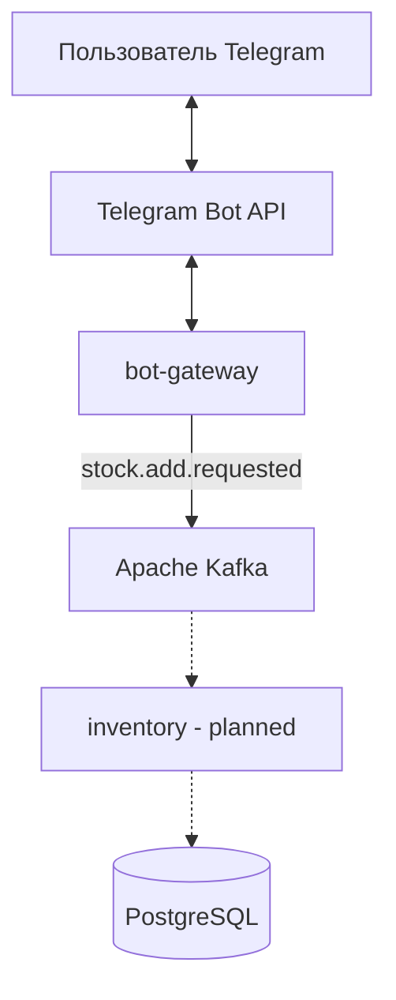

# tg-marketplace

Учебный микросервисный бэкенд маркетплейса на Go с интерфейсом в виде Telegram-бота.

Цель проекта — практическое изучение микросервисной архитектуры, событийного взаимодействия, надёжной обработки сообщений и контейнеризации сервисов.

## Сервисы

| Сервис | Назначение | Статус |
|---|---|---|
| `bot-gateway` | Взаимодействие с Telegram Bot API, публикация событий в Kafka | Реализуется |
| `ledger` | Счета, переводы с двойной записью, идемпотентность | В разработке |
| `inventory` | Остатки, резервирование и списание товаров | Запланирован |

## Стек

Используется:

- Go
- PostgreSQL 16
- Apache Kafka 3.9 (KRaft)
- Docker и Docker Compose

Планируется:

- Redis
- Prometheus
- Grafana
- Kubernetes

## Структура проекта

```text
tg-marketplace/
├── contracts/
├── deploy/
├── services/
│   ├── bot-gateway/
│   ├── inventory/
│   └── ledger/
└── README.md
```

## Архитектура



На текущем этапе реализована цепочка от получения команды пользователя до публикации события в Kafka.

Обработка событий сервисом inventory и изменение остатков в PostgreSQL будут реализованы на следующих этапах.

## Запуск

### Требования

- Docker
- Docker Compose v2
- Токен Telegram-бота, полученный через BotFather
- Go 1.23 или новее для локальной разработки и тестирования

### Настройка окружения

Из корневой директории проекта создать файл конфигурации, если он ещё не существует:

```bash
cp -n deploy/.env.example deploy/.env
```

Заполнить необходимые переменные окружения в `deploy/.env`.

Файл `.env` содержит секреты и не должен попадать в Git.

### Запуск сервисов

```bash
docker compose -f deploy/docker-compose.yml up -d --build
```

Проверить состояние контейнеров:

```bash
docker compose -f deploy/docker-compose.yml ps -a
```

Сервис `kafka-init` автоматически создаёт необходимые топики после запуска Kafka.

Завершение `kafka-init` со статусом `Exited (0)` является штатным поведением.

### Сетевые адреса

| Сервис | С хоста | Внутри Docker |
|---|---|---|
| PostgreSQL | localhost:5433 | postgres:5432 |
| Kafka | localhost:9092 | kafka:29092 |

Kafka использует отдельные listeners для внутренних и внешних подключений.

Порт Kafka на хосте привязан к `127.0.0.1`.

Данные PostgreSQL и Kafka сохраняются в именованных Docker volumes.

## Bot Gateway

Сервис взаимодействия с пользователями через Telegram Bot API.

### Реализованный функционал

- Получение сообщений через long polling.
- Управление Telegram offset.
- Обработка команд `/start` и `/add`.
- Валидация входных данных.
- Отправка сообщений пользователю.
- Синхронная публикация событий в Kafka.
- Детерминированная генерация UUID событий.
- Повторная обработка обновлений при ошибках публикации.
- Graceful shutdown через context и сигналы SIGINT/SIGTERM.
- Многоэтапная сборка Docker-образа.
- Запуск приложения от непривилегированного пользователя.
- Поддержка подключения через HTTP-прокси.

### Команды бота

| Команда | Описание |
|---|---|
| `/start` | Приветственное сообщение |
| `/add Название Количество` | Запрос на увеличение остатка товара |

Примеры:

```text
/add Яблоки 10
/add Зеленые яблоки 15
/add Красные груши 20
```

Название товара может состоять из нескольких слов.

Количество должно быть положительным целым числом.

Подтверждение от бота означает успешную публикацию запроса в Kafka, а не фактическое изменение остатка товара в базе данных.

### Переменные окружения

| Переменная | Описание |
|---|---|
| `TELEGRAM_BOT_TOKEN` | Токен Telegram-бота |
| `BOT_HTTPS_PROXY` | Необязательный адрес прокси, доступный из контейнера |
| `KAFKA_BROKER` | Адрес Kafka-брокера |
| `KAFKA_TOPIC` | Топик для публикации событий |

При запуске через Docker Compose:

- `KAFKA_BROKER` устанавливается в `kafka:29092`.
- `KAFKA_TOPIC` устанавливается в `stock.add.requested`.
- `BOT_HTTPS_PROXY` передаётся в контейнер как `HTTPS_PROXY`.

При локальном запуске Go-приложения переменные окружения необходимо передать непосредственно процессу.

### Локальный запуск

Из директории `services/bot-gateway`:

```bash
export KAFKA_BROKER=localhost:9092
export KAFKA_TOPIC=stock.add.requested

go run .
```

Перед запуском необходимо установить `TELEGRAM_BOT_TOKEN`.

При необходимости подключения через прокси используется переменная `HTTPS_PROXY`.

Kafka должна быть запущена, а необходимые топики созданы.

Не следует одновременно запускать несколько экземпляров bot-gateway с одним токеном Telegram-бота.

### Запуск bot-gateway через Docker Compose

```bash
docker compose -f deploy/docker-compose.yml up -d --build bot-gateway
```

Kafka и сервис инициализации топиков запускаются автоматически как зависимости.

### Просмотр логов

```bash
docker compose -f deploy/docker-compose.yml logs -f bot-gateway
```

### Остановка

```bash
docker compose -f deploy/docker-compose.yml stop bot-gateway
```

## Kafka

### Топики

| Топик | Назначение | Партиции |
|---|---|---:|
| `stock.add.requested` | Запросы на увеличение остатков | 3 |
| `bot-gateway-test` | Интеграционное тестирование | 1 |

В текущем окружении используется один Kafka-брокер с replication factor 1.

### Контракт события

Контракт: [Stock Add Requested](contracts/stock.add.requested.md).

Статус контракта: Draft.

Пример события:

```json
{
  "event_id": "550e8400-e29b-41d4-a716-446655440000",
  "product_name": "Зеленые яблоки",
  "quantity": 15,
  "requested_at": "2026-11-27T14:33:00Z"
}
```

Kafka message key — название товара.

### Надёжность доставки

- Синхронная публикация событий.
- Подтверждение записи через `RequireAll`.
- Продвижение Telegram offset после успешной публикации.
- Повторная обработка команды при ошибке Kafka.
- Стабильный event_id при повторной обработке одного Telegram update.

Модель доставки допускает повторную публикацию событий (at-least-once).

Для предотвращения повторного изменения остатков будущий inventory consumer должен выполнять дедупликацию по `event_id` атомарно с изменением данных.

### Просмотр событий

Из корневой директории проекта:

```bash
docker compose -f deploy/docker-compose.yml exec kafka \
  /opt/kafka/bin/kafka-console-consumer.sh \
  --bootstrap-server kafka:29092 \
  --topic stock.add.requested \
  --from-beginning \
  --property print.key=true
```

## Тестирование

Все Go-команды выполняются из директории `services/bot-gateway`.

### Статический анализ

```bash
go vet ./...
```

### Unit-тесты

```bash
go test -v ./...
```

Проверяются:

- Парсинг команды `/add`.
- Валидация количества товара.
- Обработка некорректных команд.
- Создание события.
- Корректность UUID.
- Детерминированность идентификатора события.

### Integration-тесты

Для запуска требуется работающая Kafka с топиком `bot-gateway-test`.

```bash
go test -tags=integration -v -count=1 ./...
```

Интеграционный тест проверяет успешную публикацию сообщения в Kafka.

### Проверенные вручную сценарии

- Получение и обработка Telegram updates.
- Публикация JSON-события в Kafka.
- Чтение опубликованного события из Kafka.
- Обработка некорректных команд.
- Повторная обработка команды после восстановления Kafka.
- Graceful shutdown при недоступности брокера.
- Восстановление обработки команды после перезапуска бота.
- Автоматическое создание Kafka-топиков.
- Сохранение сообщений после пересоздания контейнера Kafka.
- Запуск bot-gateway от непривилегированного пользователя.

## Ограничения и технический долг

Проект находится на этапе разработки и не предназначен для production-эксплуатации.

- Kafka работает с одним брокером без резервирования.
- Kafka использует PLAINTEXT без аутентификации и шифрования.
- PostgreSQL опубликован на порту 5433 хоста.
- Авторизация пользователей Telegram пока не реализована.
- Telegram offset хранится в памяти приложения.
- Дедупликация событий на стороне consumer пока не реализована.
- Не реализованы автоматические тесты управления offset.
- Требуется расширение интеграционных тестов с проверкой Kafka key и JSON payload.
- Требуется проверка graceful shutdown при зависших сетевых операциях.
- Конфигурации разработки и production пока не разделены.

## Roadmap

- [x] Базовая инфраструктура Docker Compose.
- [x] Telegram Bot Gateway.
- [x] Kafka producer и команда `/add`.
- [ ] Согласование контракта событий.
- [ ] Ledger service.
- [ ] Inventory service.
- [ ] Kafka consumer.
- [ ] Идемпотентная обработка событий.
- [ ] Авторизация пользователей.
- [ ] Сквозное тестирование микросервисов.
- [ ] Redis.
- [ ] Prometheus и Grafana.
- [ ] Kubernetes.
